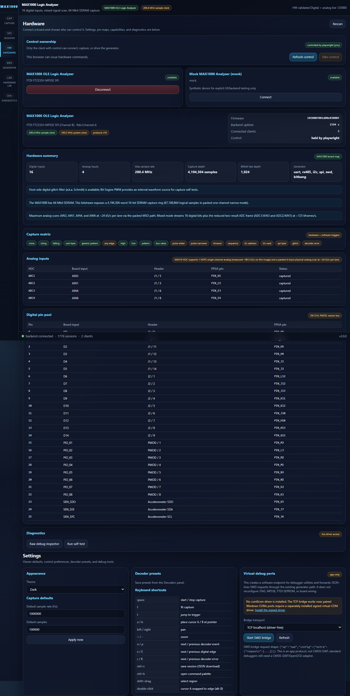
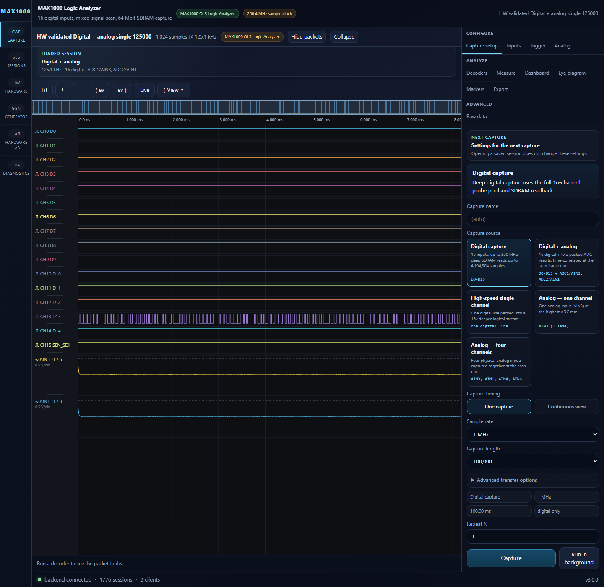
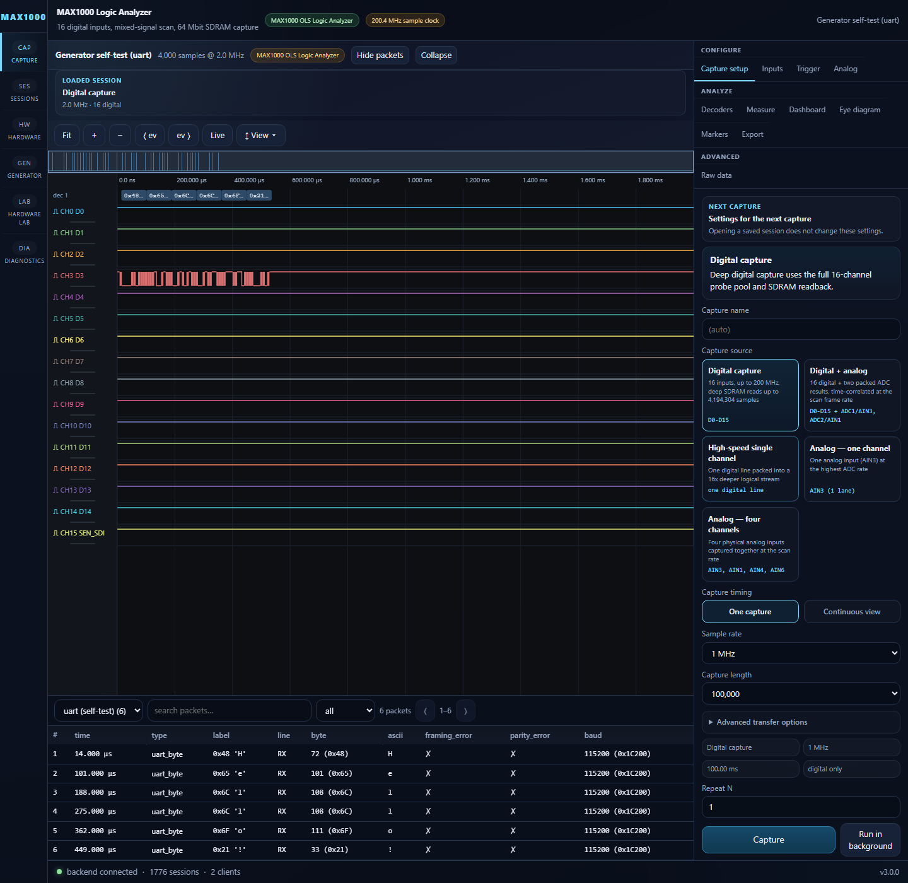
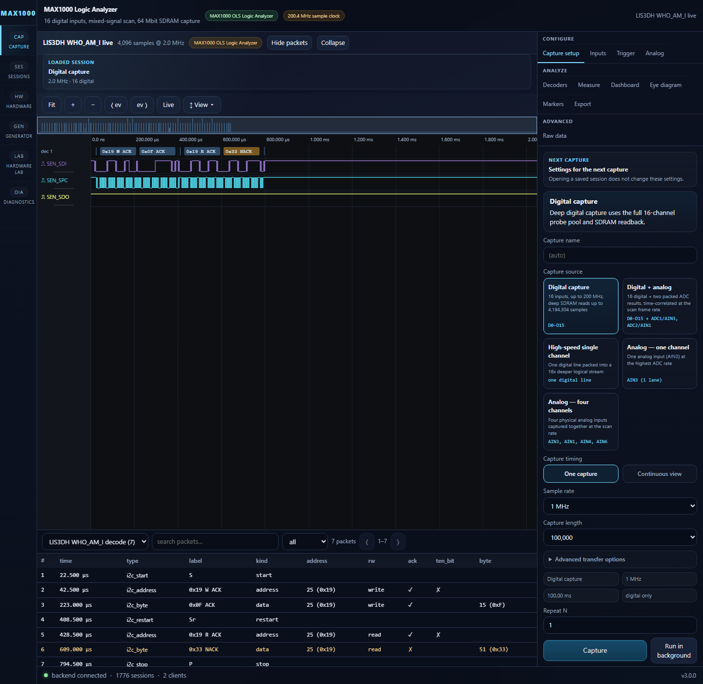
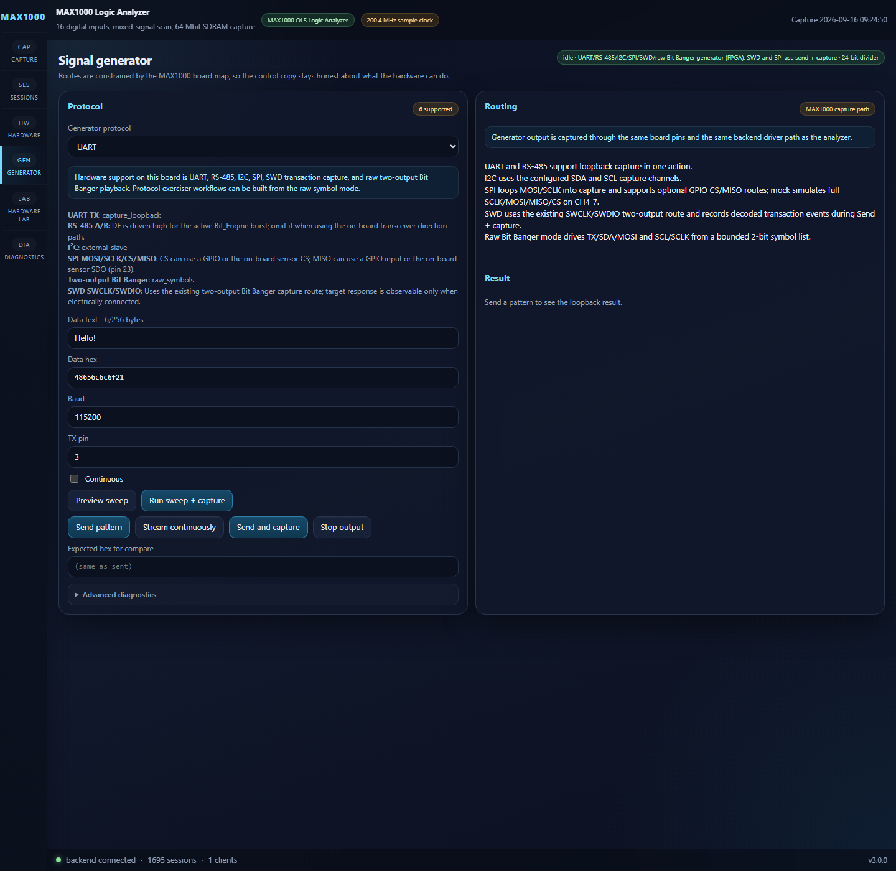
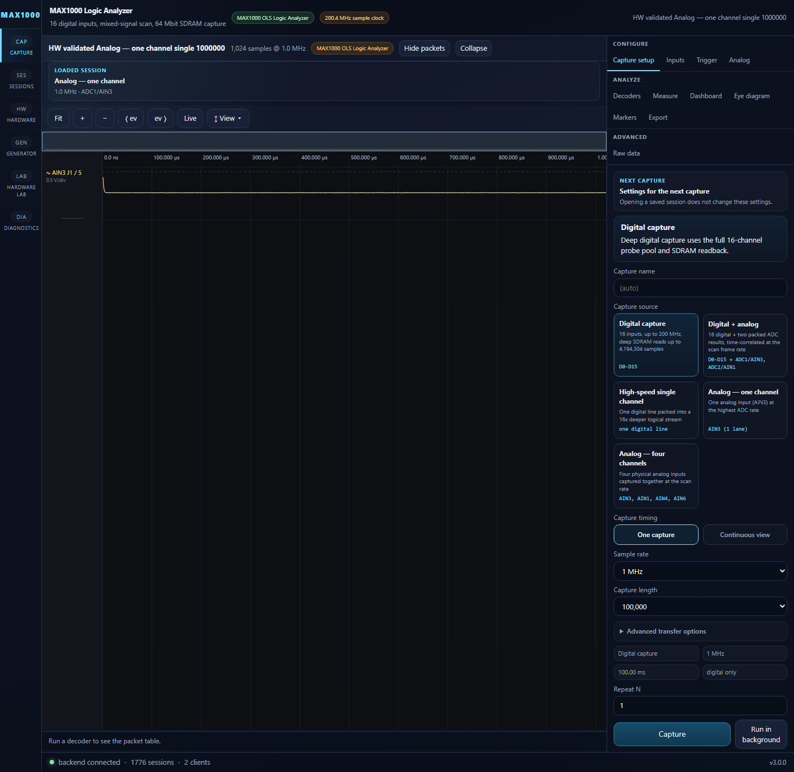
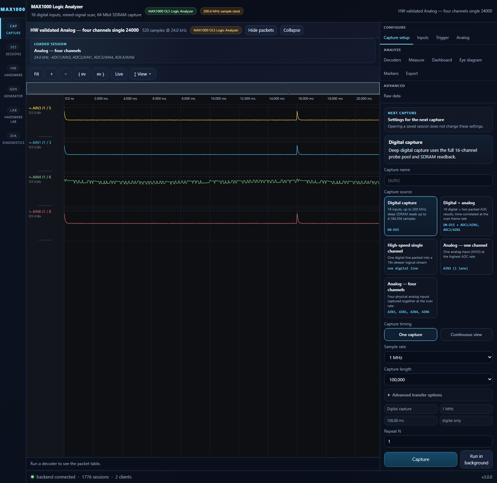
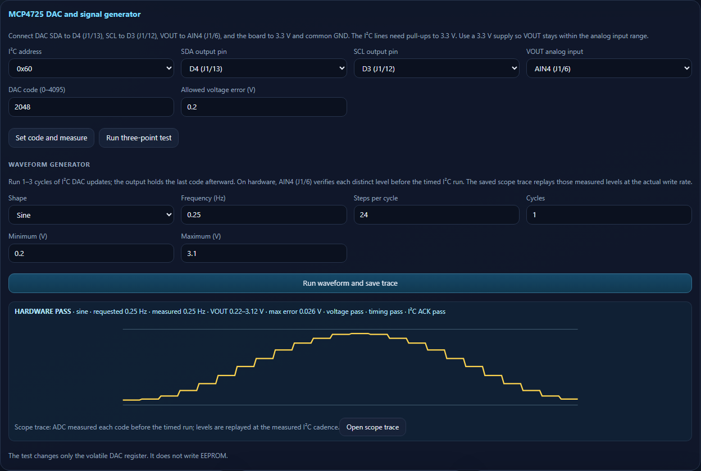

# OLS Logic Analyzer for MAX1000

OLS is a mixed-signal logic analyzer, capture backend, and signal-generator
stack for the Arrow MAX1000 board built around the Intel MAX 10 10M08. The
current repository includes:

- FPGA RTL for 200 MHz digital capture with SDRAM-backed deep storage
- The original Python host driver and tkinter tooling in [`host/`](host/)
- A FastAPI backend plus React frontend for browser-based capture and analysis
- Hardware validation, smoke tests, and regression tests for host, backend, and UI
- A wired MCP4725 DAC test and bounded analogue signal generator in the MIL tab
- A MAX6675 thermocouple datalogger for up to four channels in the MIL tab

The full-device reference image and host stack have the validation recorded
below. The seed-7 image also passed timing, was verified in flash, and
passed focused MCP4725 and capture-path board checks on 2026-09-28.
The SDRAM read path was fixed on 2026-11-13 and continuous capture was made
lossless under host reads on 2026-11-15 (seed-1 image, generation 3); see
[Rebuilding The FPGA Image](#rebuilding-the-fpga-image).

## Current Status

This repository is currently verified for:

- 16-channel digital capture to the full SDRAM depth at up to 100.2 MS/s
- 16-channel capture at the full 200.4 MHz sample clock keeps a contiguous
  prefix of about `15,000` samples and reports the overflow (the SDRAM write
  pump runs at 167 MHz and cannot sustain 200.4 M words/s)
- Deep SDRAM single-shot capture up to `4,194,304` 16-bit words
- Packed narrow digital capture at 200 MHz for one selected channel
- Continuous (live) capture that keeps storing every sample while the host
  reads, up to 100.2 MS/s on 16 channels and 200 MHz on one channel, with a
  dropped-sample counter the host can read. The USB link delivers about
  1 MS/s to the host, so faster live streams are sampled, with the skipped
  stretches flagged
- Mixed capture with 16 digital bits plus the reduced two-result ADC frame
- Analog-fast capture of 1 ADC lane
- Maximum-analog capture of 4 physical analog inputs
- UART, RS-485, I2C, SPI, SWD transaction capture, and raw two-output Bit Banger generation
- Browser UI, backend API, and classic host-driver workflow
- MCP4725 voltage checks and 0.25–2 Hz stepped waveforms with selectable I²C pins and analogue input

The full-device baseline below was recorded on the 2026-09-09 image. The
MCP4725 work has separate, focused physical evidence from 2026-09-28; the
earlier full-device counts do not establish a full regression on that later
pin-map change.

Latest full-device validation baseline (2026-09-09):

- `backend/app/tests`: `542/542` passed at 100% statement/branch coverage
- `host/tests/` + `host/driver/tests/`: `1,010/1,010` passed at 100% statement/branch coverage
- `frontend`: `292/292` passed at 100% statement/branch/function/line coverage; production build passed
- Cold-power-cycle connected-fixture hardware regression: **436/436 passed, 0 failed, 0 skipped**
- Native GHDL regression: **57/57 passed**, with zero XFAIL/XPASS/exclusions
- Real-browser hardware validation: **5/5 feature tests** (including all 37 advertised mode/rate combinations) and **34/34 hardware-aligned UI tests**

## What The Current Bitstream Actually Does

### Digital

- 16 digital inputs from a programmable pin pool
- 200.4 MHz sample clock in the validated FAST build
- 1024-word BRAM fast path for small captures
- 64 Mbit SDRAM deep capture path for large single-shot and bounded live workflows
- Narrow packed mode stores 16 time samples for one selected channel in each 16-bit word

### Analog and Mixed

The current hardware exposes two analog capture profiles plus the mixed scan.

- `analog_fast`: 1 ADC lane, currently `ADC1 -> AIN3`
- `analog_all` / "Maximum analog": `ADC1,2,3,4 -> AIN3, AIN1, AIN4, AIN6`
- `mixed`: 16 digital bits plus physical ADC1/ADC2 results (`a1`/`a2`, AIN3/AIN1) in one time-correlated frame

On MAX1000, the current mixed wire format is the reduced two-result path. The
maximum-analog profile is the separate four-input physical scan over `AIN3`,
`AIN1`, `AIN4`, and `AIN6`.

### Readback Compression

Digital readback supports:

- `raw`
- `delta_rle` packed-delta-plus-RLE and direct `rle` in the host/UI surface

For the currently validated hardware block-read path, compressed capture blocks
decode from exact RLE block payloads with zero raw-retry fallback on the tested
board. On a recent hardware check with a compressible digital waveform, the
compressed block-read path delivered about `1.81x` faster readback than raw.

Analog and mixed captures use raw readback.

## Clock and Memory Summary

The validated FAST build uses one PLL with these main domains:

| Output | Frequency | Purpose |
| --- | --- | --- |
| `c0 -> sys_clk` | 100.2 MHz | SPI packet protocol, generator, UI-facing control logic |
| `c1 -> fast_clk` | 200.4 MHz | Digital sample capture and packing |
| `c2 -> sdram_core_clk` | 167 MHz | SDRAM controller, write pump, readout |
| `c4 -> sdram_chip_clk` | 167 MHz, phase-shifted | Forwarded SDRAM device clock |

Main storage paths:

- `1,024`-word BRAM capture path
- `4,096`-word async FIFO between capture and SDRAM
- `4,194,304` 16-bit SDRAM words for deep capture / bounded ring workflows

## UI Screenshots

The general capture screenshots below were regenerated on 2026-09-16 from the
attached MAX1000 and the then-persistent seed-10 image. The MCP4725 screenshot
was recorded separately on 2026-09-28. The browser tests require the named
session to be active and its waveform payload to finish loading before writing
each PNG.

### Device Overview



### Mixed-Signal Capture



This capture is deliberately signal-dense so the digital transitions and ADC
waveform remain legible when the README image is shown at its normal size.

### Live Generator Loopback



### On-board LIS3DH Capture



### Generator Controls



### Analog Fast Hardware Waveform (1 ADC lane)



*Current one-lane analog-fast acquisition on AIN3 (J1/5) at a measured
1.002 MS/s. The trace is the actual attached-board input, not synthetic data.*

### Maximum Analog Hardware Waveform (4 ADC lanes)



*AIN3, AIN1, AIN4, and AIN6 captured together at 24 kS/s per lane. The four
distinct traces include the attached fixture response and floating-input
activity present during the validation run.*

### MCP4725 DAC in the MIL tab



*On the verified, timing-clean seed-7 image, the wired DAC passed voltage, I²C
ACK, and host-timed rate checks at 24 steps per cycle and 0.25 Hz. The displayed
trace replays analogue levels measured before the timed run; it is not a
simultaneous fast analogue capture.*

The [MCP4725 wiki guide](docs/wiki/mcp4725.md) covers wiring, selectable
routes, test controls, and limits. The [timing-clean physical test record](docs/evidence/mcp4725-fast-timing-clean/README.md)
contains seven screenshots and raw browser results.


## Running It

### Browser App

Requirements: Python 3.10+, Node.js 18+, and, for real hardware, the FTDI
D2XX driver plus the Python `ftd2xx` package. From a fresh checkout:

```powershell
cd C:\path\to\OLS_Logic_Analyzer_Clean
python -m pip install -r backend\requirements.txt
cd frontend
npm install
npm run build
cd ..\backend
python run.py
```

Open `http://localhost:8000`. For frontend development with hot reload, leave
the backend running and use a second shell:

```powershell
cd frontend
npm run dev
```

The Vite server runs at `http://localhost:5173` and proxies API/WebSocket
traffic to the backend. For a no-hardware check, open **Device**, connect
**Mock MAX1000 Analyser**, then choose a demo on **Capture**.

To test an MCP4725, open **MIL** after connecting the board. The wiring
measured on 2026-11-16 is SDA to FPGA pin H4 (D3, J1/12), SCL to FPGA pin J1
(D4, J1/13), VOUT to AIN4 (J1/6), plus 3.3 V and common ground. The card opens
with SDA D5 and SCL D4, an earlier reported route that never received an ACK,
so select SDA D3 along with the actual address and analogue input. The I²C
lines need pull-ups to 3.3 V. Run **Run three-point test** before **Run
waveform and save trace**. The [MCP4725 guide](docs/wiki/mcp4725.md) lists the
measured header layout. Mock mode exercises the controls and saves a
synthetic scope session; it does not verify external wiring.

The MIL tab also has a MAX6675 thermocouple datalogger. It reads up to four
converters at a set interval, shows live values, graphs them and exports CSV.
It saves the log to disk, resumes after a backend restart, reconnects the board
after a disconnect, and has per-channel offsets, high/low/fault alarms, notes
and a run length. The tested wiring is two sensors: SO, CS and SCK on PMOD 1-3,
and on D4, D3 and D2. A read takes about 0.4 s per channel. See the
[MAX6675 guide](docs/wiki/max6675.md).

For the attached MAX1000, install the FTDI D2XX driver, connect the board, and
select **MAX1000 OLS Logic Analyzer** → **Connect**. Verify the complete device
path with:

```powershell
python backend\hw_smoke_test.py
```

### Windows packaged app

To build the portable Windows executable, use a Windows PowerShell prompt from
the repository root:

```powershell
python -m pip install -r desktop\requirements-build.txt
.\desktop\build-windows.ps1
```

The output is placed under `desktop\dist\`. Opening the `.exe` starts both the
backend and the frontend; users do not need to run two terminals. Real hardware
still requires the FTDI D2XX driver. See [WEBAPP.md](WEBAPP.md) and
[desktop/README.md](desktop/README.md) for build options and troubleshooting.

### Classic Host App

The original host tools remain under [`host/`](host/). See
[host/README.md](host/README.md).

## Validation Commands

### Backend and Host Tests

```powershell
$env:PYTHONPATH='backend'
python -m pytest backend/app/tests/test_existing_host_adapter.py
python -m pytest backend/app/tests/test_mcp4725.py

$env:PYTHONPATH='host'
python -m pytest host/driver/tests/test_ols_spi_device.py host/driver/tests/test_ols_spi.py
```

### Frontend Checks

```powershell
npm --prefix frontend run typecheck
npm --prefix frontend run build
$env:PLAYWRIGHT_USE_MOCK='1'
npm --prefix frontend run test:e2e -- hardware.spec.ts

cd frontend
npx vitest run src/components/MilMcp4725Card.test.tsx src/api/client.test.ts
cd ..
```

### Hardware Smoke Test

```powershell
python backend/hw_smoke_test.py
```

### Full Hardware Validation

```powershell
cd host
python -m app.hw_validation
```

## Rebuilding The FPGA Image
The 2026-09-28 final build used Quartus seed `7`. The compile, timing gate, and
flash programming completed successfully; verify-only at 17:46:54 confirmed
that the image matched MAX 10 configuration flash before the physical retests.
The POF SHA-256 is
`C65DDA0E8042156024F1170EF967316D072CBF9BADFA67A735EC51BE7FFEC18C` and its
Programmer checksum is `0x01DE1DE1`. Slow 85 °C post-fit setup slack is
`fast_clk` +0.046 ns, `sys_clk` +0.183 ns, and SDRAM +0.396 ns. See the
[current-status wiki](docs/wiki/current-status.md) and [final image evidence](docs/evidence/mcp4725-fast-timing-clean/README.md).

```powershell
cd hdl\proj
.\compile.ps1 -Seed 7
```

The current image (generation 4, 2026-11-16) is built with seed `17`, which is
what the project file selects. On top of the 2026-11-13 read-timing fix (the
controller latches DQ inside the chip's CL3 data window,
`RD_WAIT_EXTRA_CYCLES = 3` in `hdl/rtl/SDRAM_Controller_Custom.vhd`) it keeps
the SDRAM write pump running between bursts of host reads in continuous mode,
fixes the 1-in-17 word loss in narrow 200 MHz capture, adds a dropped-sample
counter (register `0x60`, bits 15:0), makes the RLE stream always send its
last run, and removes the fixed 50 ms limit on a generator-synchronised
capture: a burst now ends when `Gen_Busy` falls or the capture fills, with a
2 s watchdog instead of a 50 ms cut, so a legitimate burst of any length is
mirrored and captured whole. `CMD_GET_METADATA` returns 12 bytes ending
`3F 04`: byte 10 holds feature flags (bit 5 = no fixed generator-capture
limit) and byte 11 the image generation, and the host driver selects its read
compensations from them, so it also works with older images.

The image uses 8,022 of 8,064 logic elements and 19 of 42 M9K blocks. Its POF
SHA-256 is
`59DBC40464DD95A4AD1869EBBD952D2B89ECC1CD0D4F2FF3E20326831FC168C0`, and slow
85 °C post-fit setup slack is `sdram_core_clk` +0.038 ns, `fast_clk` +0.073 ns,
and `sys_clk` +0.109 ns (the `sdram_dq[*]` to `sdram_s_readdata[*]` path keeps
+2.417 ns setup and +7.595 ns hold at slow 85 °C, and +6.200 ns setup and
+4.713 ns hold at fast 0 °C). Timing is seed-sensitive: seeds 1, 2, 3, 5, 7, 9,
11 and 13 failed the timing gate for this RTL (seed 3 by 4 ps) and seed 17 is
the first that passed, so re-sweep seeds after any RTL change. On the attached
board (2026-11-16) the image passed the hardware validation suite (433/433,
with the bench jumper not decoding so three checks did not run), the
74-testbench GHDL regression, a 20 s live 16-channel stream at 100.2 MS/s
(producer slope within 0.001 % of the request, dropped-sample counter at zero),
and ten full-depth 4,194,304-sample captures at 100.2 MS/s with uniform run
lengths and no dropped samples.

```powershell
cd hdl\proj
.\compile.ps1 -Seed 17
```

For more detail, see:

- [hdl/README.md](hdl/README.md)
- [TIMING_REPORT_SUMMARY.md](TIMING_REPORT_SUMMARY.md)
- [WEBAPP.md](WEBAPP.md)

## Repository Layout

- `backend/` - FastAPI backend, hardware adapter, session store, API tests
- `frontend/` - React UI, waveform viewer, Playwright E2E tests
- `hdl/` - RTL, Quartus project, constraints, simulation
- `host/` - Python SPI driver, tkinter app, classic validation tooling
- `docs/` - design notes and mode-planning documents

## License

MIT
