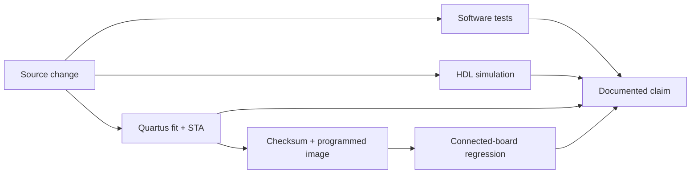

# Verification and Change Traceability

This page separates source coverage, simulation, post-fit timing, and
connected-board evidence. A feature is not hardware-validated merely because
its source or simulation exists.

## Evidence levels

| Level | Meaning |
|---|---|
| **SW** | Host/backend/frontend tests; no FPGA or board claim |
| **SIM** | Focused or maintained HDL simulation |
| **BUILD** | Quartus fit succeeds and all required timing checks close |
| **HW** | The exact programmed image passes the relevant board test |

## Full-device reference signoff record (2026-09-09)

The later MCP4725 pin-order change has focused wired-board evidence and is not
covered by this full-device signoff. A local 2026-09-28 Quartus timing summary
has negative setup slack for `fast_clk` and `sys_clk`; see
[Current Status](current-status.md). Do not inherit the earlier clean STA or
436/436 full-suite claim for the changed source.

| Field | Current evidence |
|---|---|
| Source baseline | 2026-09-16; commit `47bce3d` (`Close global coverage gaps`) atop `a84501e` (`Harden accelerometer live transport`) |
| Build | Quartus Prime Lite 25.1, full mixed-signal profile, fitter seed 10 |
| Image | Programmed into configuration flash on 2026-09-09; SOF checksum `0x0050492F` |
| Timing | Slow-85C setup: fast +0.253 ns, SDRAM +0.178 ns, system +0.278 ns; all setup/hold/recovery/removal/min-pulse checks positive |
| Hardware smoke | 10/10 |
| Full hardware suite | Cold-power-cycle run 436/436 with 0 failed and 0 skipped; preceded by two consecutive 421/421 runs, 842/842 combined; includes active codec references, all 75 crosstalk cases, exact jumper protocol payloads, both strict 60-second stress runs, and final concurrent capture/readout |
| Host coverage | 1,010 tests; 8,342 statements and 2,488 branches at 100%, zero partial branches |
| Backend coverage | 633 passed, 1 opt-in hardware skip; 10,968 statements and 3,386 branches at 100%, zero partial branches |
| Frontend coverage | 391 passed, 1 opt-in hardware skip; 4,412 statements, 3,359 branches, 1,110 functions, and 3,780 lines at 100% |
| Browser hardware matrix | 5/5 feature tests, including 37/37 advertised mode/rate combinations; 26 digital/mixed cases require physical 22→CH13 transitions (40–875 observed); broader hardware-aligned suite 34/34; 114 screenshots regenerated and visually checked using the 1440px documentation viewport plus targeted panel/full-content captures |
| Rate sweep | Current image: 7/7 from 1,200-115,200 baud, every case within +0.79% |

The complete matrix manifest and per-case session IDs are in
[`hardware-validated-matrix.json`](../../frontend/test-results/screenshots/hardware-validated-matrix.json).
The fit, STA, and assembler reports are in `hdl/proj/output_files/`.

## Change-to-evidence matrix

| Change | Primary implementation | Evidence | Level |
|---|---|---|---|
| Ordered accelerometer waveform transport | `backend/app/websocket/manager.py`, `accelerometer.py`, `frontend/src/workers/accelerometerStream.worker.ts` | Per-client binary/text queue tests, worker packet-order/reconnect tests, connected binary-stream test, live backlog watch | **SW + HW** |
| Slow-client eviction and recovery | WebSocket manager and `ReconnectingSocket` | Slow-client isolation, explicit socket close, reconnect, and legacy text-fallback tests | **SW** |
| Separate source, transport, and browser timing metrics | Accelerometer status model, worker messages, `MilAccelerometerCard` | Status/worker/UI tests; live backlog observation | **SW + HW** |
| Live waveform request correlation and coalescing | `frontend/src/workers/`, `waveformStore.ts`, session persistence | Worker unit tests, frontend build/E2E, live hardware captures | **SW + HW** |
| Manual-session selection versus newest-capture updates | `CapturePage`, waveform canvas identity/loading contract | Rendered regression test plus exact-session live screenshot gallery | **SW + HW** |
| Generator output during rolling capture | backend adapter, host driver, Generator page | Backend/host tests; live generator capture and clean stop | **SW + HW** |
| Exact generator rate and corrected square preset | generator preview/status and host divider model | Protocol/unit tests and on-wire rate sweep | **SW + HW** |
| 24-bit `REG_GEN_BAUD` and metadata feature byte | `Bit_Engine`, `OLS_Interface`, core/top wiring, host detection | `tb_bit_engine_div24`, Quartus seed sweep, rate sweep | **SIM + BUILD + HW** |
| SDRAM init comparator register | `SDRAM_Controller_Custom.vhd` | Post-fit STA, full hardware regression | **BUILD + HW** |
| Auto-discovered analogue jumper fixture | `host/app/hw_validation.py` | Current 421-check suite; missing fixture makes the suite fail via a nonzero skip result | **HW** |
| Bounded final SPI plateau decode | `host/app/gui_decoders.py` | Host tests and full connected-board suite | **SW + HW** |
| Expanded regression/coverage gates | CI workflows, backend/host/frontend tests, HDL runner | Backend 633-test and frontend 391-test production scopes at literal 100%; 57/57 HDL benches with no exclusions | **SW + SIM** |
| MCP4725 selectable bus, analogue test, and bounded waveform | `backend/app/mil/mcp4725.py`, host fast I²C RX FIFO, MIL card, corrected MKR/PMOD pin map | [2026-09-28 physical results](../evidence/mcp4725-fast-2026-09-28/README.md): D4/D3/AIN4 at `0x60`, three-point levels and ACKs, 20 writes/s pass, wrong-address NACK; 506 pin pairs covered in software only | **SW + focused HW** |

## Historical image records

| Date | Image | Result | Status |
|---|---|---:|---|
| 2026-07-22 | seed 23, SOF `0x004FDDF3` | 369/369 | Historical |
| 2026-07-23 | seed 44, SOF `0x00515DB0` | 358/358 | Historical |
| 2026-07-27 | repaired seed 30, SOF `0x0050CF93` | 391/391 after focused corrections | Historical |
| 2026-08-07 | pin-map/pull-up image, SOF `0x0051801E` | smoke 10/10 | Historical |
| 2026-08-27 | seed 10 wide-divider, SOF `0x0050ADC8` | 383/383 + 37/37 | Persistent historical baseline |
| 2026-09-04 | repaired seed 10, SOF `0x00504799` | full suite 396/396; corrected 60-second stress 29/29; smoke 10/10; changed paths 117/117; strict codec/rate 26/26 | Historical volatile baseline |
| 2026-09-09 | seed 10, SOF `0x0050492F` | unplug/replug discovery and full suite 436/436; browser hardware 5/5 and 34/34; 37-case screenshot matrix and all 114 PNGs refreshed again on 2026-09-16 | Historical full-device reference; cold-boot persistence recorded |
| 2026-09-28 | MCP4725 pin-map and fast I²C work | [Focused DAC electrical and waveform checks](../evidence/mcp4725-fast-2026-09-28/README.md); latest local STA summary has negative setup slack | Focused board evidence only; full-device signoff pending |

Historical results remain useful regression evidence, but they do not prove a
later RTL image. The MCP4725 board checks prove the narrower wiring, voltage,
ACK, and host-timed waveform behavior documented in their own record.

## CI and local gates

| Gate | Command/workflow | Contract |
|---|---|---|
| Backend | `python -m pytest backend/app/tests` | 100% statement and branch coverage |
| Host | `python -m pytest host/tests host/driver/tests` | 100% statement and branch coverage |
| Frontend unit | `npm run test:unit` | 100% statement, branch, function, and line coverage for all production TS/TSX; the normal run leaves only the explicitly hardware-gated live test skipped |
| Frontend E2E | `PLAYWRIGHT_USE_MOCK=1 npm run test:e2e -- hardware.spec.ts` | Browser workflows without hardware |
| HDL gate | `bash hdl/tb/run_all_tbs.sh` | All 57 `tb_*.vhd` benches must terminate explicitly and pass; no exclusions/XFAILs |
| Hardware matrix | `.github/workflows/hardware-matrix.yml` | Self-hosted `max1000` runner; board absence is a failure |

## Audit rules

- Record source baseline, profile, fitter seed, tool version, image checksum,
  test date, and result beside every new **HW** claim.
- Re-run post-fit STA after any RTL, SDC, QSF, pin, fitter, or toolchain
  change. Seed 10 is not evidence for modified inputs.
- Keep missing external fixtures explicit. A decoder or open-loop generator
  test does not prove CAN, LIN, SWD/JTAG target response, MIL, RS-485
  differential electrical behavior, or the other external-bus protocols.
- Treat the installed ADC3/ADC7 jumpers as activity/isolation evidence only;
  absolute voltage calibration, linearity, bandwidth, and driven coverage of
  ADC1/ADC2 remain external-fixture gaps.
- Packed-live capture cannot use the on-board Bit Engine as an independent
  electrical stimulus because both paths share capture-arm state. Its current
  proof is structural/functional; driven electrical proof needs an external
  source.
- `source_backlog_samples` measures unread FPGA/ring source data only. It is
  not a browser queue metric. Use the separate waveform packet count, sequence
  gaps, disconnect count, frontend decode latency, capture-to-publish latency,
  decode-to-publish latency, and WebSocket-to-render timing when diagnosing
  live transport health.
- Ordered waveform clients are lossless while healthy. Binary and legacy text
  waveform queues are per-client and bounded to two pending chunks; a slow
  client is removed from the topic and its socket is explicitly closed with a
  retryable close so the frontend can reconnect. The pose topic remains a
  replaceable latest-value mailbox by design.
- Do not add silent HDL exclusions or expected failures. A new `tb_*.vhd`
  bench must explicitly terminate and pass in the required gate.
- Update [Current Status](current-status.md), the
  [Feature Matrix](feature-matrix.md), and [Hardware Validation](hardware-validation.md)
  whenever the current image or board baseline changes.

## Evidence locations

| Evidence | Location |
|---|---|
| HDL tests and classification | [`hdl/tb/`](../../hdl/tb/) and [HDL Testbenches](hdl/testbenches.md) |
| Quartus build and timing | [`hdl/proj/`](../../hdl/proj/) and [Build Flow](hdl/build-flow.md) |
| Connected-board validation | [`host/app/hw_validation.py`](../../host/app/hw_validation.py) and [Hardware Validation](hardware-validation.md) |
| Backend and host tests | [`backend/app/tests/`](../../backend/app/tests/) and [`host/driver/tests/`](../../host/driver/tests/) |
| Frontend unit/E2E evidence | [`frontend/`](../../frontend/) and [Frontend Build & Test](frontend/build-and-test.md) |
